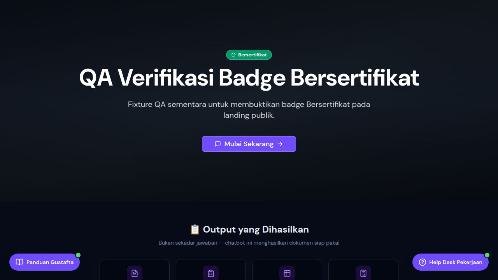

# Verifikasi Badge Bersertifikat

Tanggal verifikasi: 31 Agustus 2026

## Hasil

Fixture QA sementara `QA Verifikasi Badge Bersertifikat` dibuat sebagai agen
non-official (`isGustafta=false`), milik kreator (`isCreatorMade=true`), listed,
dan bersertifikat. Selama fixture aktif, tiga endpoint berikut mengembalikan
`isCertified=true`:

- `http://127.0.0.1:5000/api/landing/9706`
- `https://gustafta.my.id/api/landing/9706`
- `https://landing-page-Esterkristian26.replit.app/api/landing/9706`

Preview UI menampilkan badge hijau **Bersertifikat** pada landing produk:



Fixture QA kemudian dihapus. Audit sesudah cleanup kembali menunjukkan
`0` agen produksi dengan `is_certified=true`; tidak ada produk pelanggan yang
diubah atau dibiarkan berstatus sertifikasi untuk keperluan tes.

## Verifikasi Otomatis

Jalankan:

```bash
npx tsx --test \
  tests/landing-bersertifikat-contract.test.ts \
  tests/curation-badge-flag-removal.test.ts
```

Hasil saat verifikasi: 10 tes lulus, 0 gagal.

Tes integrasi HTTP + database membuktikan mapper mengembalikan
`isCertified=true`. Tes kontrak landing memastikan bagian Beli menggunakan
flag yang sama untuk badge hijau, label `Bersertifikat`, test ID, dan urutan
prioritas badge (Gustafta Official lebih dahulu, lalu Bersertifikat, lalu
fallback kreator).